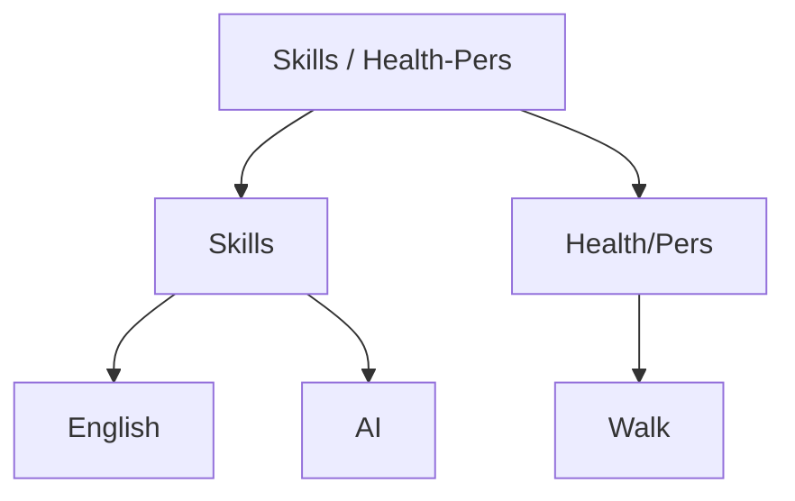

# Test
text

| File | Link |
|---|---|
| `AI.md` | [View](https://github.com/hamidhp/testGithub/blob/master/AI.md) |
| `LICENSE` | [View](https://github.com/hamidhp/testGithub/blob/master/LICENSE) |
| `README.md` | [View](https://github.com/hamidhp/testGithub/blob/master/README.md) |
| `Test.md` | [View](https://github.com/hamidhp/testGithub/blob/master/Test.md) |
| `new.py` | [View](https://github.com/hamidhp/testGithub/blob/master/new.py) |
| `obsidian.md` | [View](https://github.com/hamidhp/testGithub/blob/master/obsidian.md) |
| `py_test.py` | [View](https://github.com/hamidhp/testGithub/blob/master/py_test.py) |
| `todo.md` | [View](https://github.com/hamidhp/testGithub/blob/master/todo.md) |

